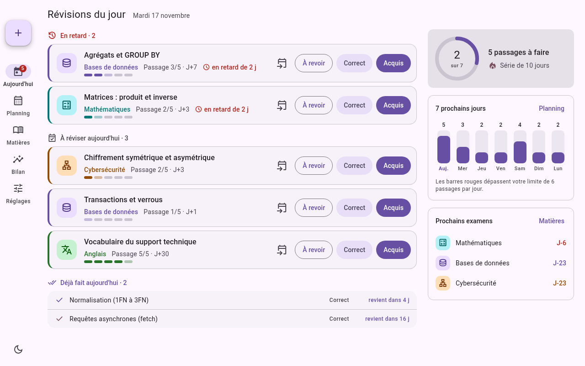
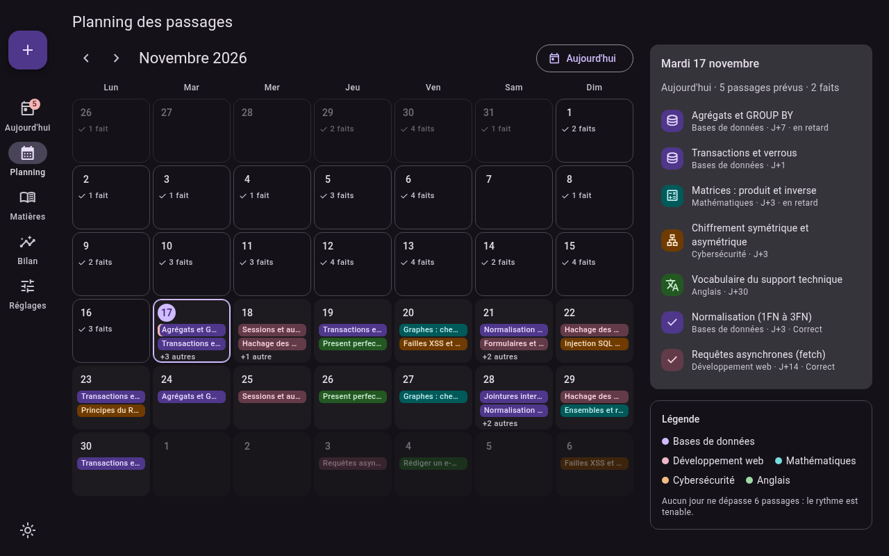
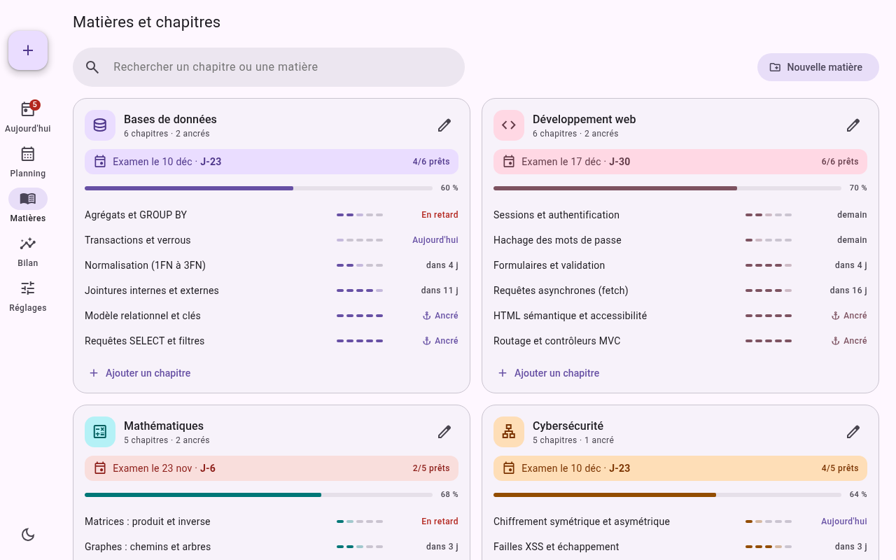
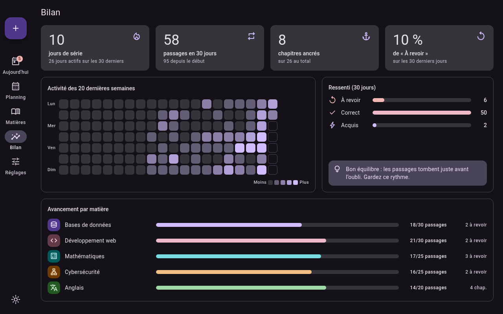

<p align="center">
  
</p>

<p align="center">
  <a href="https://github.com/JulesROGUE/ancrage/releases/latest"></a>
  
  
  <a href="LICENSE"></a>
</p>

<p align="center">
  <b>Chaque chapitre revient au bon moment : J+1, J+3, J+7… juste avant de l'oublier.</b><br>
  Une application de bureau pour suivre la méthode des J sans tableur ni agenda, 100 % hors ligne.
</p>

<p align="center">
  <a href="https://github.com/JulesROGUE/ancrage/releases/latest"><b>⬇️ Télécharger pour Windows ou Linux</b></a>
</p>

---

## Pourquoi Ancrage ?

Relire un cours la veille d'un partiel donne l'impression de le connaître, mais il s'efface vite. La **répétition espacée** (la « méthode des J ») consiste à revoir chaque chapitre à intervalles croissants : le lendemain, trois jours plus tard, une semaine, deux semaines, un mois.

La méthode est simple ; le suivi, beaucoup moins. Avec cinq matières et une trentaine de chapitres, savoir **quoi revoir aujourd'hui** devient un casse-tête de tableur. Ancrage fait ce calcul à votre place :

- vous notez le chapitre le jour où vous l'étudiez (J0) ;
- chaque jour, l'app affiche les passages à faire, ceux en retard, et ce qui est déjà fait ;
- vous indiquez votre ressenti (**À revoir**, **Correct** ou **Acquis**) et le prochain passage se recalcule tout seul.

Tout reste sur votre ordinateur : pas de compte, pas de serveur, aucune donnée envoyée.

## Aperçu

<p align="center">
  
  
</p>
<p align="center">
  
  
</p>

## Fonctionnalités

| | Fonctionnalité | Détail |
|---|---|---|
| 📅 | **Révisions du jour** | Passages en retard, à faire et déjà faits, avec la progression de la journée et votre série de jours. |
| 🔁 | **Méthode des J** | Rythmes Classique (J+1, J+3, J+7, J+14, J+30), Intensif, Long terme ou personnalisé. |
| 🎯 | **Ressenti à chaque passage** | « À revoir » reprogramme le lendemain, « Acquis » allonge l'intervalle de 50 %. |
| 🗓️ | **Planning mensuel** | Tous les passages prévus, jour par jour, avec une alerte quand une journée dépasse votre limite. |
| 📚 | **Matières et examens** | Couleur et icône par matière, date d'examen, compte à rebours et nombre de chapitres revus à temps. |
| 📊 | **Bilan** | Activité sur 20 semaines, taux de « À revoir », avancement par matière et un conseil de rythme. |
| ↩️ | **Annulation** | Chaque action (passage, report, suppression) peut être annulée depuis la notification. |
| 💾 | **Sauvegarde** | Export et import d'un fichier JSON pour changer de poste ou garder une copie. |
| 🌗 | **Thème clair / sombre** | Suit le système ou se règle à la main. |

## Installation

Rendez-vous sur la page **[Releases](https://github.com/JulesROGUE/ancrage/releases/latest)** et choisissez le fichier adapté :

| Système | Fichier | Usage |
|---|---|---|
| Windows | `Ancrage-Setup-1.0.0.exe` | Installateur classique (raccourcis, désinstallation). |
| Windows | `Ancrage-1.0.0-portable.exe` | Version portable : un seul fichier, sans installation. |
| Linux | `Ancrage-1.0.0-linux-x86_64.AppImage` | `chmod +x` puis double-clic, sur toutes les distributions. |
| Linux | `Ancrage-1.0.0-linux-amd64.deb` | Debian, Ubuntu, Mint : `sudo apt install ./Ancrage-1.0.0-linux-amd64.deb` |

> **Note Windows (SmartScreen)** : l'exécutable n'est pas signé avec un certificat payant. Au premier lancement, Windows peut afficher « Windows a protégé votre ordinateur » : cliquez sur **Informations complémentaires**, puis **Exécuter quand même**. Le code source est entièrement consultable ici, et les fichiers sont compilés par GitHub Actions.

## Développement

```bash
git clone https://github.com/JulesROGUE/ancrage.git
cd ancrage
npm install
npm start        # compile l'interface et lance l'application
npm run dist     # crée les installateurs dans release/
```

| Brique | Choix |
|---|---|
| Interface | React 19 (JSX) + Vite |
| Application de bureau | Electron 45 (renderer isolé, sans accès Node) |
| Design | Composants Material You maison, Roboto et Material Symbols embarqués hors ligne |
| Données | `localStorage` dans le profil de l'application, export / import JSON |
| Logique | `src/lib/schedule.js` : calcul des passages, projection, série, préparation aux examens |
| Builds | electron-builder, compilé pour Windows et Linux par GitHub Actions à chaque tag `v*` |

```
src/
├── App.jsx               navigation (NavigationRail + location.hash), état et actions
├── views/                Aujourd'hui, Planning, Matières, Bilan, Réglages
├── components/           dialogues, anneau de progression, pastilles de passages
└── lib/                  dates, méthode des J, matières
```

## Licence

[MIT](LICENSE) © Jules ROGUE

- Icônes [Material Symbols](https://github.com/google/material-design-icons) : licence Apache 2.0
- Police [Roboto](https://fonts.google.com/specimen/Roboto) : SIL Open Font License (OFL)
